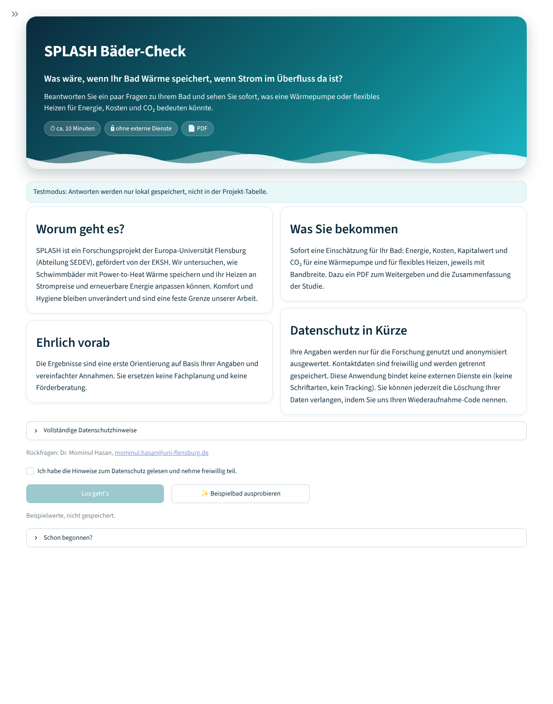
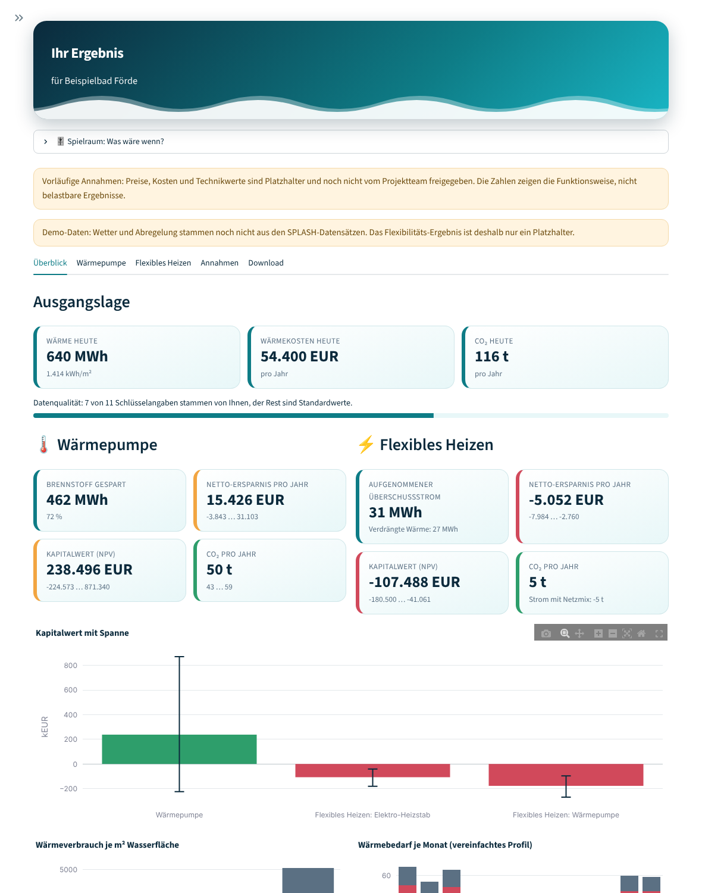

# SPLASH Questionnaire and Simulation (SPLASH Fragebogen und Simulation)

An interactive questionnaire for swimming pool operators. While operators describe their pool, the app
calculates an instant result: what a **heat pump** or **flexible heating with curtailed renewable power**
could mean for energy, cost, net present value (NPV) and CO2. Every answer is saved to a Google Sheet.

Built for the SPLASH project (Europa-Universität Flensburg, SEDEV, funded by EKSH). German and English.




## Status: read this first

The calculation and the interface are complete and tested. **The economic numbers are not yet project results.**
`data/parameters.yaml` has `status: draft_unvalidated`. Prices, costs and technology values marked `illustrative`
are placeholders. The app shows a yellow banner until they are replaced and the status is set to `validated`.

The physical part is different: **all heat demand comes from the SPLASH facility model v1.3** (vendored unchanged in
`vendor/splash`, hashes in `vendor/MANIFEST.sha256`) with **hourly operator curtailment of 2025 and 2026 for the zones T5 and T6**. Its remaining
assumptions (typical-year weather, basin occupancy, hall geometry) are listed on the results page and in
[docs/METHODS.md](docs/METHODS.md). See [docs/DEPLOYMENT.md](docs/DEPLOYMENT.md), section "Before the survey goes out".

## Flexible heating in one paragraph

Each basin of the questionnaire becomes a SPLASH basin with its own temperature band (setpoint up to setpoint plus the
accepted change). The model computes basin and hall heat demand hourly. An electric resistive heater, sized at
**100 %, 200 % and 300 % of the pool's design load**, runs on curtailed power only: it covers hall and basins first and
then charges the basin water up to the upper limit. The results page shows, for 2025 and 2026, how much curtailed power
the pool absorbs, how much fossil heat it displaces, investment, NPV with range, break-even electricity price and CO2.

## Hot water for showers

Visitors drive the shower demand. The operator enters visitors per day (weekday, weekend) or per year, the open days and weeks, and says
whether the pool plant heats the shower water. The model adds hot water (50 L per visitor by default, 40 degC) to the hall load, the
design load and the heater size. Details: [docs/METHODS.md](docs/METHODS.md), section 2b.

## What an operator gets

| Step | Content |
|---|---|
| Welcome | Project, privacy, consent, example pool, resume with a code |
| 1 Pool | Basins, hall, opening hours, ventilation, operator type |
| 2 Energy | Heat sources, annual consumption, optional costs |
| 3 Flexibility | Willingness, accepted temperature variation, needs and barriers |
| 4 Results | Technology choice (heater default, heat pump, compare), five sections (today, thermal battery, technologies, curtailment, finance), seven visualisations, provenance badges, "what if" controls, PDF and CSV downloads |
| 5 Refine (optional) | Boiler, grid connection, district heat contract |
| 6 Follow-up | Interview, optional contact, summary request |

The questionnaire keeps all 14 questions of the project draft v1 (38 items) and adds 33 items for the
calculation and the research design. See [docs/QUESTIONNAIRE_MAPPING.md](docs/QUESTIONNAIRE_MAPPING.md).

## Run it locally

```bash
python -m venv .venv && source .venv/bin/activate     # Windows: .venv\Scripts\activate
pip install -r requirements.txt
streamlit run app.py
```

Without secrets the app stores answers in a local SQLite file and shows a "test mode" banner.
Open `http://localhost:8501`. Click "Beispielbad ausprobieren" to see a full result in a few seconds.

## Deploy (no university server needed)

1. Put this repository on GitHub.
2. Deploy it on Streamlit Community Cloud.
3. Create the Google Sheet and a service account, then paste the secrets.

Step by step: [docs/DEPLOYMENT.md](docs/DEPLOYMENT.md) and [docs/GOOGLE_SHEETS_SETUP.md](docs/GOOGLE_SHEETS_SETUP.md).

## Project area

Open the app with `?admin=1` and enter the admin password. You see counts, answers and results, and can
download an Excel export. Contact data are never in that export. They have their own download.

## Personal links

Send each pool a link like `https://your-app.streamlit.app/?pool=k3f9a1x7q2m8`. The app then pre-fills name,
city, postal code, pool type and operator type from `data/pool_prefill.csv` (see the example file) until the
token expires. Tokens are random, not derived from the pool name. `data/pool_prefill.csv` is git-ignored on purpose (it links
pools to tokens). On Streamlit Community Cloud the feature therefore has no data unless you deploy the file another way;
see docs/DEPLOYMENT.md.

## Repository layout

```
app.py                      Streamlit entry point
splash_calc/                Calculation core, no Streamlit. Fully testable.
  params.py                 Versioned parameters, cases, overrides
  inputs.py                 Questionnaire answers to typed inputs, data provenance
  baseline.py               Today's heat, cost and CO2
  profiles.py               Hourly heat demand by use, taken from the SPLASH model
  climate.py                Zone mapping, heat pump weather
  heatpump.py               Heat pump with hourly COP and bivalent sizing
  splash_engine.py          Questionnaire pool to SPLASH facility, runs the charging rule
  flexsplash.py             Flexible heating KPIs per year and heater size
  subsidy.py                BEG grant (KfW 522 and 422)
  economics.py              NPV, payback, break-even price, CO2
  scenarios.py              Orchestration, three cases, tornado analysis
vendor/splash/              SPLASH model v1.3 (unchanged, hashes in vendor/MANIFEST.sha256), data in data/splash/
splash_app/                 Interface, storage, PDF, admin
data/                       parameters.yaml, questions.yaml, privacy notice, real data
docs/                       Methods, deployment, Sheets setup, data protection, mapping
tests/                      150+ tests including end-to-end app tests
```

## How the numbers are built

Short version: today's heat is split into four uses (pool water, hall air, hot water, space heating) and
turned into hourly profiles from weather and opening hours. A heat pump is sized for the served load and runs
with an hourly COP. Flexible heating runs on the SPLASH facility model (basin physics, hall demand, hysteresis
charging rule) on hourly curtailment data. Costs use NPV over the evaluation period, with three cases (pessimistic, central, optimistic) and a
tornado chart. Full equations: [docs/METHODS.md](docs/METHODS.md).

## Tests

```bash
pip install -r requirements-dev.txt
pytest -q          # calculation, questionnaire, storage, end-to-end app flow
ruff check .
python scripts/validate_data.py     # checks curtailment, calendars and the SPLASH data package
```

CI runs the same on every push (`.github/workflows/ci.yml`).

## Known limits

* Open-air pools get flexible heating but no heat pump scenario.
* Weather is a typical year, not the weather of 2025 or 2026. 2026 curtailment ends on 22 November and is not scaled.
* The zone mapping from the postcode is a placeholder (`data/real/zones.csv`); the zone can be chosen in the app.
* The model demand can differ from the reported consumption (it can be high against the UBA median). The results page shows the gap; an optional switch scales the model to your meter data.
* Flexible heating uses the SPLASH hysteresis rule, not the optimiser. Hall geometry and occupancy are SPLASH assumptions.
* The curtailed power price is not guaranteed by any tariff. The default is 23 EUR/MWh (project assumption).
  The break-even price shows what would be needed.
* A grant is not a right. Rules change (BEG changed on 21 July 2026, caps fall on 1 February 2027).
* The Google Sheets backend is tested against a mock. Test it once with your real sheet (see the setup guide).
* Results do not replace professional planning.

## Licence

MIT, see [LICENSE](LICENSE). Change it if the project requires another licence.

## Kurzfassung (Deutsch)

Der SPLASH Fragebogen und Simulation ist ein Online-Fragebogen für Bäderbetreiber mit Sofort-Ergebnis. Er rechnet für das eigene Bad
Energie, Kosten, Kapitalwert und CO2 für eine Wärmepumpe und für flexibles Heizen mit Überschussstrom. Alle
Antworten landen automatisch in einer Google-Tabelle. Die App läuft kostenlos auf Streamlit Community Cloud,
ein eigener Server wird nicht gebraucht. Das flexible Heizen nutzt das SPLASH-Modell mit stündlicher Abregelung 2025 und 2026
(Zonen T5, T6) und Heizstäben mit 100, 200 und 300 % der Auslegungslast. **Wichtig:** Die Wirtschaftlichkeit ist erst ein
Projektergebnis, wenn die Platzhalter in `data/parameters.yaml` ersetzt sind.
Anleitung: [docs/DEPLOYMENT.md](docs/DEPLOYMENT.md).
